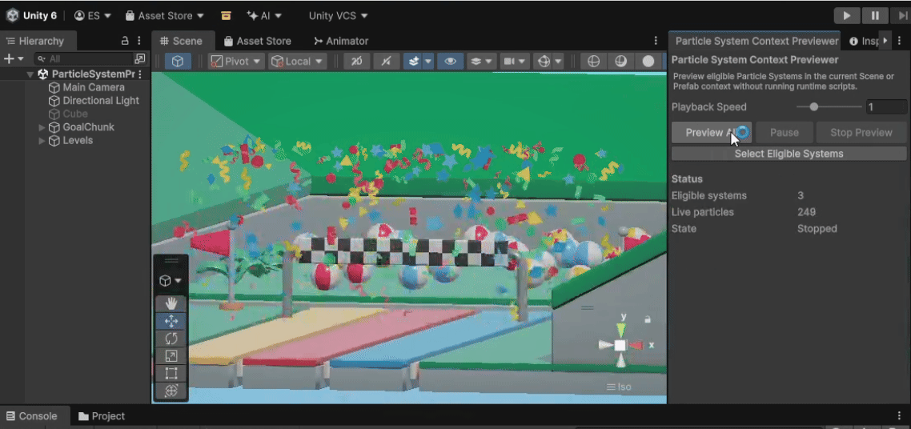
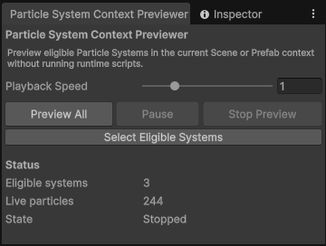
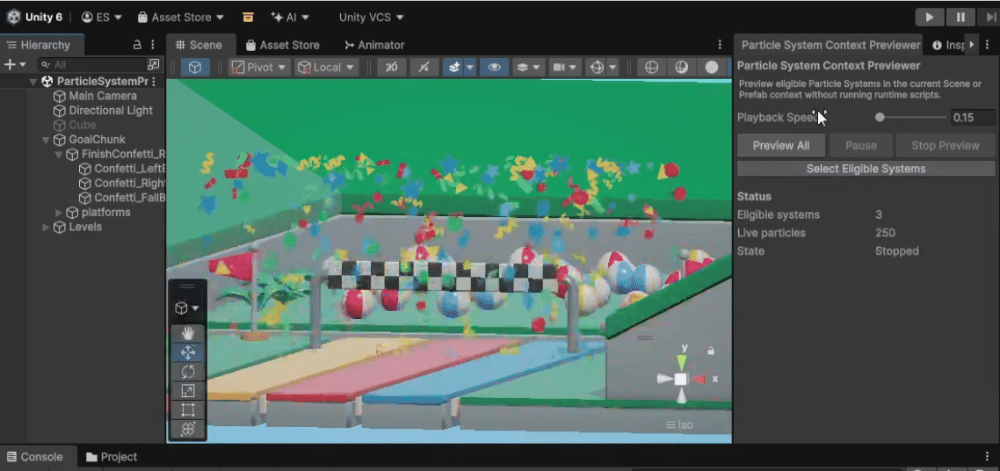

# Particle System Context Previewer

Preview eligible Particle Systems across the current Scene or Prefab Stage directly in Edit Mode, without entering Play Mode or running runtime scripts.

The current context is the active Prefab Stage when one is open; otherwise it is all currently loaded scenes.

## Features

- Context-wide Particle System preview in Edit Mode.
- Prefab Stage support.
- All-loaded-scenes support outside Prefab Stage.
- Child and nested Particle System discovery.
- `Preview All`, `Restart All`, and `Stop Preview` controls.
- `Playback Speed` from `0.1x` to `4x`.
- Automatic context and eligible-set tracking.
- `Select Eligible Systems` for selecting the currently eligible Particle System GameObjects.
- Selection-gated `Pause` / `Resume`.
- Natural non-looping completion; use `Restart All` to replay.
- Best-effort restoration of live particles, basic playback state, and Scene View visibility settings.

## Installation

1. Copy `Editor/ParticleSystemContextPreviewerWindow.cs`.
2. Place it in an `Editor` folder in your Unity project, for example:
   `Assets/Editor/ParticleSystemContextPreviewerWindow.cs`
3. Let Unity compile.
4. Open `Tools > Particle System Context Previewer`.

No third-party packages are required.

## Usage

1. Open `Tools > Particle System Context Previewer`.
2. Click `Preview All` to preview eligible Particle Systems in the current context.
3. Adjust `Playback Speed` if needed.
4. Use `Restart All` to replay/restart the current context preview.
5. Use `Stop Preview` when finished.

The Status section shows:

- `Eligible systems`
- `Live particles`
- `State` (`Stopped`, `Previewing`, or `Paused`)

Non-looping systems complete naturally. Use `Restart All` to replay them.

## Pause / Resume

`Preview All` alone does not enable Pause.

Pause is gated through Unity's normal visible selection so the tool can pause the exact eligible set reliably. Use one of these workflows:

`Select Eligible Systems` -> `Preview All` -> `Pause`

or:

`Preview All` -> `Select Eligible Systems` -> `Pause`

`Select Eligible Systems` selects the currently eligible Particle System GameObjects and arms Pause for the current preview/context state.

Pause is available only while preview is running and the visible Unity selection still exactly matches the eligible set. Changing selection disables the Pause gate. If selection changes while paused, the preview resumes.

## How Context Works

### Prefab Stage

When a Prefab Stage is open, that prefab is the exclusive preview context.

### Scenes

When no Prefab Stage is open, all currently loaded scenes are part of the context.

### Automatic Tracking

The tool automatically tracks relevant context and eligible-system changes.

If the context or eligible Particle System set changes during preview, the tool stops the current preview, performs best-effort restoration, rescans, and remains idle.

## Eligibility

Eligible Particle Systems:

- are under the current context
- are active in hierarchy
- have a `ParticleSystemRenderer`
- have that renderer enabled
- are not `forceRenderingOff`

Child and nested Particle Systems are included.

`Play On Awake` is not required for preview eligibility.

## Scene View Visibility

During preview, the tool temporarily enables the Scene View FX and particle visibility settings Unity requires to render Particle Systems. Because particle rendering depends on the broader Scene View FX state, the Scene View appearance may temporarily change while preview is active.

The previously captured Scene View settings are restored best-effort when preview ends.

## Notes / Limitations

- Edit Mode preview only.
- Runtime scripts are not executed by the previewer.
- Script-driven effects may differ from Play Mode.
- Restoration is best-effort.
- Live particles and basic playback state are restored where possible.
- Exact internal Particle System simulation state is not guaranteed.
- Scene View FX and particle visibility settings are restored best-effort.
- Pause depends on the eligible systems remaining visibly selected.

## Tested With

Tested with Unity 6000.3.15f1.

## License

MIT License. See `LICENSE`.
